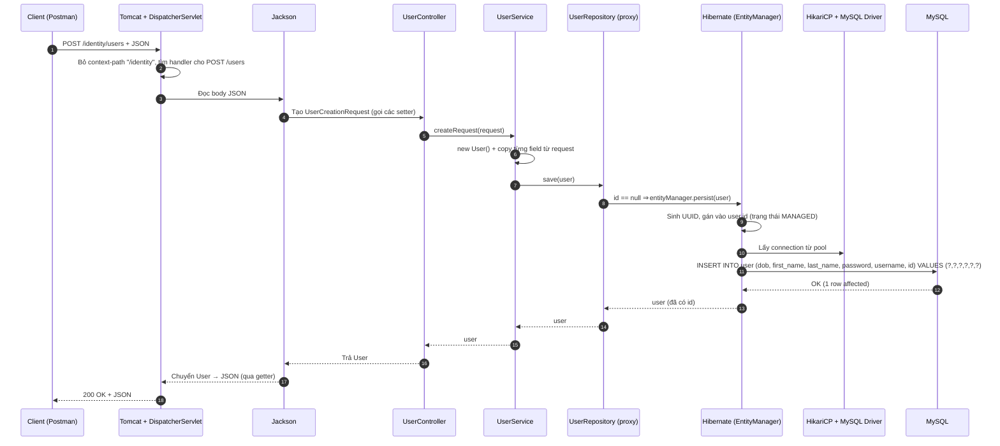

# Identity Service – Kiến trúc, vai trò từng package, và JPA/Hibernate

> Tài liệu này giải thích project `identity-service` (Spring Boot 4.1.2, Java 25, MySQL).
> Mục tiêu: hiểu **mỗi package để làm gì**, **chúng gọi nhau thế nào**, và **JPA / Hibernate thực sự chạy ra sao**.

---

## Mục lục

1. [Bức tranh tổng thể](#1-bức-tranh-tổng-thể)
2. [Cấu trúc project hiện tại](#2-cấu-trúc-project-hiện-tại)
3. [Vai trò từng package](#3-vai-trò-từng-package)
4. [Các package liên kết với nhau thế nào](#4-các-package-liên-kết-với-nhau-thế-nào)
5. [JPA và Hibernate là gì](#5-jpa-và-hibernate-là-gì)
6. [Workflow chi tiết: tạo User từ A đến Z](#6-workflow-chi-tiết-tạo-user-từ-a-đến-z)
7. [Khởi động ứng dụng: chuyện gì xảy ra trước khi có request](#7-khởi-động-ứng-dụng-chuyện-gì-xảy-ra-trước-khi-có-request)
8. [Cấu hình: pom.xml và application.yaml](#8-cấu-hình-pomxml-và-applicationyaml)
9. [Những điểm cần lưu ý / việc còn thiếu](#9-những-điểm-cần-lưu-ý--việc-còn-thiếu)
10. [Bảng tra nhanh](#10-bảng-tra-nhanh)

---

## 1. Bức tranh tổng thể

Project dùng **kiến trúc phân tầng (layered architecture)**. Mỗi tầng chỉ làm **một việc** và chỉ nói chuyện với tầng **ngay bên cạnh**.

```
   Client (Postman / Frontend / Mobile)
        │   HTTP + JSON
        ▼
┌─────────────────────────────────────────────┐
│  CONTROLLER   – cửa vào, nhận/trả HTTP      │  ← (CHƯA CÓ trong project)
├─────────────────────────────────────────────┤
│  DTO          – "hộp" chứa dữ liệu vào/ra   │  dto.request (đã có)
├─────────────────────────────────────────────┤
│  SERVICE      – logic nghiệp vụ             │  UserService
├─────────────────────────────────────────────┤
│  REPOSITORY   – nói chuyện với database     │  UserRepository
├─────────────────────────────────────────────┤
│  ENTITY       – class ánh xạ 1 bảng DB      │  User
└─────────────────────────────────────────────┘
        │   SQL (do Hibernate sinh ra)
        ▼
     MySQL  (database: identity_service)
```

**Quy tắc vàng:** dữ liệu chảy **xuống** (Controller → Service → Repository → DB) rồi kết quả chảy **ngược lên**. Controller **không bao giờ** gọi thẳng Repository; Entity **không bao giờ** lộ thẳng ra ngoài nếu tránh được.

---

## 2. Cấu trúc project hiện tại

```
identity-service/
├── pom.xml                                   ← khai báo thư viện (Maven)
├── docs/                                     ← tài liệu (file này)
└── src/main/
    ├── java/com/oabga/identity_service/
    │   ├── IdentityServiceApplication.java   ← điểm khởi động (main)
    │   ├── controller/                       ← ❌ CHƯA TẠO
    │   ├── dto/
    │   │   └── request/
    │   │       └── UserCreationRequest.java  ← dữ liệu client gửi lên
    │   ├── entity/
    │   │   └── User.java                     ← ánh xạ bảng `user`
    │   ├── repository/
    │   │   └── UserRepository.java           ← truy cập DB
    │   └── service/
    │       └── UserService.java              ← logic tạo user
    └── resources/
        └── application.yaml                  ← cấu hình port, DB
```

---

## 3. Vai trò từng package

### 3.1 `IdentityServiceApplication` (root package)

```java
@SpringBootApplication
public class IdentityServiceApplication {
    public static void main(String[] args) {
        SpringApplication.run(IdentityServiceApplication.class, args);
    }
}
```

- `@SpringBootApplication` = 3 annotation gộp lại:
  - `@Configuration` – class này có thể khai báo bean.
  - `@EnableAutoConfiguration` – Spring Boot **tự cấu hình** dựa trên thư viện có trong `pom.xml` (thấy `data-jpa` + `mysql` → tự dựng Hibernate + kết nối MySQL; thấy `webmvc` → tự dựng Tomcat + DispatcherServlet).
  - `@ComponentScan` – **quét** package `com.oabga.identity_service` **và mọi package con** để tìm class gắn `@Service`, `@Repository`, `@Controller`, `@Entity`...
- **Vì sao class này phải nằm ở package gốc?** Vì `@ComponentScan` chỉ quét từ package của nó trở xuống. Nếu đặt `controller` ngoài `com.oabga.identity_service`, Spring sẽ **không thấy** nó.

---

### 3.2 `controller` – Cửa vào HTTP  *(chưa có, nhưng bạn sẽ cần)*

**Vai trò:** nhận HTTP request, đưa dữ liệu cho Service, trả HTTP response. **Không chứa logic nghiệp vụ.**

Ví dụ nên viết:

```java
@RestController
@RequestMapping("/users")
public class UserController {

    @Autowired
    private UserService userService;

    @PostMapping
    public User createUser(@RequestBody UserCreationRequest request) {
        return userService.createRequest(request);
    }
}
```

| Annotation | Ý nghĩa |
|---|---|
| `@RestController` | Class này xử lý HTTP và **trả JSON** (= `@Controller` + `@ResponseBody`). |
| `@RequestMapping("/users")` | Mọi endpoint trong class bắt đầu bằng `/users`. |
| `@PostMapping` | Method này xử lý `POST /users`. |
| `@RequestBody` | Lấy JSON trong body → **tự chuyển** thành object `UserCreationRequest` (nhờ thư viện Jackson). |

URL đầy đủ sẽ là: `http://localhost:8080/identity/users` (vì `context-path: /identity` trong `application.yaml`).

**Tại sao tách Controller khỏi Service?**
- Controller lo chuyện *giao thức* (HTTP, status code, JSON).
- Service lo chuyện *nghiệp vụ* (kiểm tra username trùng, mã hoá password...).
- Sau này bạn muốn gọi cùng logic từ một nguồn khác (message queue, scheduled job) thì dùng lại Service, không cần HTTP.

---

### 3.3 `dto.request` – Dữ liệu đi VÀO

**DTO = Data Transfer Object** – object chỉ để **chở dữ liệu** giữa các tầng/giữa client và server.

```java
public class UserCreationRequest {
    private String username;
    private String password;
    private String firstName;
    private String lastName;
    private LocalDate dob;
    // getter/setter...
}
```

**Vai trò:** mô tả **đúng những field client được phép gửi** khi tạo user.

**Tại sao không dùng thẳng `User` (entity) làm tham số của controller?**

| Vấn đề nếu dùng Entity trực tiếp | DTO giải quyết thế nào |
|---|---|
| Client có thể gửi cả `id` → ghi đè id do server sinh (**mass assignment**, lỗ hổng bảo mật). | `UserCreationRequest` **không có** field `id`, client không thể gửi. |
| Entity gắn chặt với bảng DB; đổi cột DB là vỡ API. | DTO là "hợp đồng API" tách biệt, DB đổi không ảnh hưởng client. |
| Mỗi API cần field khác nhau (tạo mới ≠ cập nhật ≠ đổi mật khẩu). | Mỗi API một DTO riêng: `UserCreationRequest`, `UserUpdateRequest`... |
| Dễ vô tình trả `password` ra ngoài. | DTO response (`dto.response`) chọn field nào trả ra. |

**Vì sao tên package là `dto.request`?** Vì sau này sẽ có thêm `dto.response` (dữ liệu đi **RA**). Tách đôi để rõ chiều dữ liệu:

```
dto/
├── request/    ← client → server  (UserCreationRequest, UserUpdateRequest)
└── response/   ← server → client  (UserResponse – không có password)
```

---

### 3.4 `service` – Logic nghiệp vụ

```java
@Service
public class UserService {
    @Autowired
    private UserRepository userRepository;

    public User createRequest(UserCreationRequest request) {
        User user = new User();
        user.setUsername(request.getUsername());
        user.setPassword(request.getPassword());
        user.setFirstName(request.getFirstName());
        user.setLastName(request.getLastName());
        user.setDob(request.getDob());

        userRepository.save(user);
        return user;
    }
}
```

**Vai trò:** đây là nơi **"bộ não"** của ứng dụng. Ở đây method làm 3 việc:

1. **Chuyển đổi** DTO → Entity (`UserCreationRequest` → `User`).
2. **Gọi Repository** để lưu (`save`).
3. **Trả kết quả**.

Về sau nơi này là chỗ thêm: kiểm tra username đã tồn tại chưa, mã hoá password (BCrypt), gán role, gửi email...

| Annotation | Ý nghĩa |
|---|---|
| `@Service` | Đánh dấu "đây là bean tầng service". Spring tạo **1 instance duy nhất (singleton)** và quản lý nó. |
| `@Autowired` | **Dependency Injection**: Spring tự nhét `UserRepository` vào field. Bạn **không** viết `new UserRepository()`. |

> Lưu ý: `@Autowired` trên field vẫn chạy được nhưng cách được khuyên dùng hơn là **constructor injection** (dễ test, field có thể `final`).

---

### 3.5 `repository` – Nói chuyện với database

```java
@Repository
public interface UserRepository extends JpaRepository<User, String> {
}
```

Đây là điều **gây bất ngờ nhất** với người mới: đây là **interface rỗng**, không có code nào! Vậy `save()` từ đâu ra?

- `JpaRepository<User, String>`: "repository quản lý entity `User`, khoá chính kiểu `String`".
- Khi khởi động, **Spring Data JPA tự sinh class cài đặt** (dùng dynamic proxy) cho interface này, kèm sẵn các method:

| Method có sẵn | SQL tương đương (do Hibernate sinh) |
|---|---|
| `save(user)` | `INSERT ...` (user mới) hoặc `UPDATE ...` (user đã có id) |
| `findById(id)` | `SELECT * FROM user WHERE id = ?` |
| `findAll()` | `SELECT * FROM user` |
| `deleteById(id)` | `DELETE FROM user WHERE id = ?` |
| `existsById(id)` | `SELECT count(*) ... WHERE id = ?` |
| `count()` | `SELECT count(*) FROM user` |

Bạn còn có thể **khai báo method theo tên** và Spring tự sinh query:

```java
boolean existsByUsername(String username);   // SELECT ... WHERE username = ?
Optional<User> findByUsername(String username);
List<User> findByLastNameAndFirstName(String last, String first);
```

**Vai trò:** cô lập toàn bộ việc truy cập DB vào một chỗ. Service chỉ biết "lưu user", không biết SQL là gì, không biết DB là MySQL hay PostgreSQL.

---

### 3.6 `entity` – Ánh xạ class ↔ bảng

```java
@Entity
public class User {
    @Id
    @GeneratedValue(strategy = GenerationType.UUID)
    private String id;
    private String username;
    private String password;
    private String firstName;
    private String lastName;
    private LocalDate dob;
    // getter/setter...
}
```

**Vai trò:** mỗi `@Entity` là **một bảng** trong DB; mỗi object là **một dòng**; mỗi field là **một cột**.

| Java | Database |
|---|---|
| class `User` | bảng `user` |
| field `username` | cột `username` |
| field `firstName` | cột `first_name` (Hibernate tự đổi camelCase → snake_case) |
| field `dob` (`LocalDate`) | cột `dob` kiểu `date` |
| 1 object `User` | 1 dòng trong bảng |

| Annotation | Ý nghĩa |
|---|---|
| `@Entity` | "Class này được Hibernate quản lý, ánh xạ tới một bảng". |
| `@Id` | Field này là **khoá chính** (primary key). |
| `@GeneratedValue(strategy = GenerationType.UUID)` | Giá trị id **do Hibernate tự sinh** là một UUID (vd. `3f2a9c1e-...`). Bạn không tự set. |

> `jakarta.persistence.*` là **chuẩn JPA**. Chú ý package là `jakarta` (từ Spring Boot 3 trở đi), không còn là `javax`.

---

## 4. Các package liên kết với nhau thế nào

### 4.1 Sơ đồ phụ thuộc (ai biết ai)

```
┌──────────────┐  dùng   ┌──────────────┐  dùng   ┌────────────────┐  quản lý  ┌──────────┐
│  Controller  │ ──────▶ │   Service    │ ──────▶ │   Repository   │ ────────▶ │  Entity  │
└──────┬───────┘         └──────┬───────┘         └────────────────┘           └──────────┘
       │ nhận                   │ nhận + đọc                                          ▲
       ▼                        ▼                                                     │
┌─────────────────────────────────────┐        Service tạo ra Entity từ DTO ──────────┘
│       DTO (UserCreationRequest)     │
└─────────────────────────────────────┘
```

Đọc như sau:

- `Controller` **biết** `Service` và `DTO`. **Không biết** `Repository`.
- `Service` **biết** `Repository`, `DTO`, `Entity`.
- `Repository` **biết** `Entity` (qua generic `JpaRepository<User, String>`).
- `Entity` **không biết ai cả** – nó chỉ là dữ liệu thuần.
- `DTO` **không biết ai cả**.

### 4.2 Liên kết bằng cách nào? → **Dependency Injection (IoC)**

Bạn không bao giờ viết `new UserService()` hay `new UserRepository()`. Thay vào đó:

```
Lúc khởi động, Spring quét thấy:
   @RestController UserController   ─┐
   @Service        UserService       ├─▶ tạo mỗi cái 1 object, đặt vào "IoC Container" (kho bean)
   @Repository     UserRepository   ─┘

Rồi nối dây:
   thấy  @Autowired UserService    trong Controller  → lấy bean UserService nhét vào
   thấy  @Autowired UserRepository trong Service     → lấy bean UserRepository nhét vào
```

```
            ┌───────────── IoC Container (Spring) ─────────────┐
            │                                                  │
            │   [UserController] ──inject──▶ [UserService]     │
            │                                     │            │
            │                                  inject          │
            │                                     ▼            │
            │                             [UserRepository]     │
            └──────────────────────────────────────────────────┘
```

### 4.3 Luồng chuyển đổi kiểu dữ liệu

```
JSON  ──(Jackson)──▶  UserCreationRequest  ──(Service, set từng field)──▶  User (Entity)
                                                                              │
                                                                         (Hibernate)
                                                                              ▼
                                                                  INSERT INTO user ...
```

Ngược lại, khi trả về: `User` → (Jackson) → JSON.

---

## 5. JPA và Hibernate là gì

Đây là phần khiến nhiều người rối, vì có **4 cái tên** cùng lúc. Hãy tách từng cái:

### 5.1 Bốn khái niệm, bốn tầng

```
┌────────────────────────────────────────────────────────────┐
│  Spring Data JPA   → "interface rỗng cũng có save()"       │  ← tiện ích của Spring
│  (JpaRepository)                                           │
├────────────────────────────────────────────────────────────┤
│  JPA               → bản THIẾT KẾ / chuẩn (chỉ interface)  │  ← "luật chơi"
│  (jakarta.persistence: @Entity, @Id, EntityManager...)     │
├────────────────────────────────────────────────────────────┤
│  Hibernate         → bản CÀI ĐẶT thật của JPA              │  ← "người thực thi"
├────────────────────────────────────────────────────────────┤
│  JDBC + MySQL driver → gửi câu SQL qua mạng tới MySQL      │  ← "đường ống"
└────────────────────────────────────────────────────────────┘
```

| Tên | Là gì | Ví dụ đời thường |
|---|---|---|
| **JDBC** | API cấp thấp của Java để gửi SQL tới DB. Bạn phải tự viết SQL, tự đọc `ResultSet`. | Tự lái xe thủ công, tự cài số. |
| **JPA** | Một **đặc tả (specification)** – chỉ là tập interface & annotation (`@Entity`, `@Id`, `EntityManager`). **Không tự làm được gì.** | Bản "luật giao thông": quy định phải làm gì, không phải người lái. |
| **Hibernate** | **Một cài đặt** của JPA (phổ biến nhất). Nó đọc annotation JPA và **tự sinh SQL**. | Tài xế thật, tuân theo luật. |
| **Spring Data JPA** | Lớp bọc **trên** JPA/Hibernate, giúp bạn khỏi viết cả `EntityManager`. Chỉ cần khai báo interface. | Taxi công nghệ: bạn chỉ nói "đi đâu", không lo lái. |

> **Một câu để nhớ:** *JPA là "cái gì", Hibernate là "làm thế nào", Spring Data JPA là "làm cho gọn".*
>
> Trong project này `spring-boot-starter-data-jpa` kéo về **cả ba**: Spring Data JPA + JPA API + Hibernate (mặc định).

### 5.2 ORM – ý tưởng nền tảng

**ORM = Object-Relational Mapping.** Vấn đề: code Java nghĩ bằng **object**, database nghĩ bằng **bảng/dòng**. Hai thế giới này lệch nhau ("impedance mismatch"). ORM là chiếc cầu nối:

```
 Thế giới Java (Object)               Thế giới DB (Relational)
┌──────────────────────┐             ┌──────────────────────────────┐
│ User user = new User │             │ bảng user                    │
│ user.setUsername("a")│  ◀─ORM──▶   │ ┌────┬──────────┬─────────┐  │
│ user.setDob(...)     │             │ │ id │ username │   dob   │  │
└──────────────────────┘             │ ├────┼──────────┼─────────┤  │
                                     │ │ ab │    a     │ 2000-.. │  │
                                     └─┴────┴──────────┴─────────┴──┘
```

**Không có ORM** (JDBC thuần), bạn phải viết:

```java
PreparedStatement ps = conn.prepareStatement(
    "INSERT INTO user (id, username, password, first_name, last_name, dob) VALUES (?,?,?,?,?,?)");
ps.setString(1, id);
ps.setString(2, user.getUsername());
// ... 4 dòng nữa, rồi ps.executeUpdate(), rồi đóng connection...
```

**Có ORM (Hibernate):**

```java
userRepository.save(user);   // xong. SQL do Hibernate viết.
```

### 5.3 Hibernate làm cụ thể những gì?

1. **Đọc metadata** từ annotation (`@Entity`, `@Id`...) để biết class nào ↔ bảng nào, field nào ↔ cột nào.
2. **Sinh SQL** (`INSERT`, `SELECT`, `UPDATE`, `DELETE`) đúng "phương ngữ" của MySQL (dialect).
3. **Quản lý connection** tới DB (qua connection pool HikariCP).
4. **Chuyển kết quả** `ResultSet` thành object Java.
5. **Theo dõi thay đổi** của object (dirty checking) – xem mục 5.5.
6. **Cache** (cache cấp 1 trong Persistence Context).
7. *(tuỳ chọn)* **Tạo/sửa bảng** từ entity (`ddl-auto`).

### 5.4 Các thuật ngữ cốt lõi

| Thuật ngữ | Giải thích đơn giản |
|---|---|
| **Entity** | Class Java gắn `@Entity`, tương ứng 1 bảng. |
| **EntityManager** | "Người quản lý" trung tâm của JPA: `persist`, `find`, `merge`, `remove`. `JpaRepository` dùng nó ở bên dưới. |
| **Persistence Context** (còn gọi *session* / cache cấp 1) | Một "vùng nhớ tạm" chứa các entity đang được theo dõi trong 1 transaction. |
| **Transaction** | Nhóm thao tác DB "hoặc thành công hết, hoặc huỷ hết". |
| **Flush** | Lúc Hibernate thực sự **đẩy** SQL xuống DB. |
| **Dialect** | Hibernate biết "nói" đúng SQL của từng loại DB (MySQL, PostgreSQL...). |
| **HikariCP** | Connection pool: giữ sẵn vài connection để tái sử dụng, khỏi mở/đóng liên tục. |

### 5.5 Vòng đời của một Entity (Entity Lifecycle)

Đây là chìa khoá để hiểu `save()`:

```
                new User()
                    │
                    ▼
            ┌──────────────┐
            │  TRANSIENT   │  Object bình thường, Hibernate chưa biết, chưa có trong DB
            │  (mới tạo)   │
            └──────┬───────┘
                   │ save() → persist()
                   ▼
            ┌──────────────┐        flush/commit        ┌──────────┐
            │   MANAGED    │ ─────────────────────────▶ │ Dòng mới │
            │ (được theo   │                            │ trong DB │
            │   dõi)       │ ◀── find()/query ───────── └──────────┘
            └──────┬───────┘
                   │ transaction kết thúc
                   ▼
            ┌──────────────┐
            │   DETACHED   │  Còn object nhưng Hibernate không theo dõi nữa
            └──────────────┘
                   
        remove() → trạng thái REMOVED → DELETE khi flush
```

- **Transient:** `User user = new User();` – Hibernate không biết gì về nó.
- **Managed:** sau `save()`, entity vào Persistence Context. Hibernate **theo dõi mọi thay đổi** trên nó. Nếu bạn sửa `user.setUsername("x")` khi đang managed, đến cuối transaction Hibernate tự sinh `UPDATE` mà **không cần gọi `save()` lần nữa** (*dirty checking*).
- **Detached:** transaction xong, object vẫn còn trong biến nhưng không còn được theo dõi.

### 5.6 `save()` bên trong làm gì?

`SimpleJpaRepository.save()` (class Spring Data tự dùng để cài `UserRepository`):

```java
// mã giả
if (entity.isNew()) {          // id == null → là entity mới
    entityManager.persist(entity);   // → INSERT
    return entity;
} else {
    return entityManager.merge(entity); // → SELECT rồi UPDATE
}
```

Trong project này: `user.id == null` khi mới `new User()` → `persist` → **INSERT**. Và `@GeneratedValue(UUID)` làm Hibernate **sinh UUID và gán vào `user.id`** trước khi INSERT. Đó là lý do sau `save()`, `user.getId()` đã có giá trị.

### 5.7 `@Transactional` – hiện thiếu

`SimpleJpaRepository.save()` **tự có** `@Transactional` bên trong, nên `save()` đơn lẻ vẫn an toàn. Nhưng khi Service có **nhiều thao tác DB**, bạn nên thêm `@Transactional` lên method Service để chúng cùng sống chung 1 transaction:

```java
@Transactional
public User createRequest(UserCreationRequest request) { ... }
```

---

## 6. Workflow chi tiết: tạo User từ A đến Z

Giả sử client gửi:

```http
POST http://localhost:8080/identity/users
Content-Type: application/json

{
  "username": "bao",
  "password": "12345678",
  "firstName": "Bao",
  "lastName": "Le",
  "dob": "2000-05-20"
}
```

### 6.1 Sơ đồ tuần tự (Sequence Diagram)



### 6.2 Từng bước, kèm "tại sao"

| # | Bước | Ai làm | Giải thích |
|---|---|---|---|
| 1 | Nhận request | **Tomcat** (server nhúng, có sẵn nhờ `starter-webmvc`) | Lắng nghe cổng `8080` (cấu hình trong `application.yaml`). |
| 2 | Định tuyến | **DispatcherServlet** | Cắt `/identity` (context-path), tìm method có `@PostMapping` khớp `POST /users`. |
| 3 | JSON → object | **Jackson** (qua `@RequestBody`) | Tạo `new UserCreationRequest()` rồi gọi `setUsername(...)`, `setDob(...)`.<br>⚠ DTO **phải có setter + constructor rỗng**, nếu không Jackson không điền được dữ liệu. |
| 4 | Vào Controller | `UserController` | Chỉ chuyển tiếp. Không logic. |
| 5 | Vào Service | `UserService.createUser` | Tạo `User` mới, copy field từ DTO sang Entity. **Không set id** (để Hibernate sinh). |
| 6 | Gọi Repository | `userRepository.save(user)` | `userRepository` là một **proxy** do Spring Data tự sinh lúc khởi động. |
| 7 | Quyết định INSERT/UPDATE | `SimpleJpaRepository` | `id == null` ⇒ entity mới ⇒ `persist`. |
| 8 | Sinh UUID | **Hibernate** | Do `@GeneratedValue(strategy = UUID)`. Gán vào `user.id`. Entity chuyển sang **MANAGED**. |
| 9 | Sinh SQL | **Hibernate** + Dialect MySQL | Đọc metadata → `INSERT INTO user (...) VALUES (...)`. |
| 10 | Gửi SQL | **HikariCP → MySQL Connector/J → MySQL** | Lấy 1 connection từ pool, chạy `PreparedStatement`. |
| 11 | Commit | **Transaction** (do `save()` mở) | DB lưu dòng mới. |
| 12 | Trả ngược | Repository → Service → Controller | Cùng object `user` (giờ đã có `id`). |
| 13 | Object → JSON | **Jackson** | Dùng các **getter** của `User` để dựng JSON. |
| 14 | Trả HTTP | Tomcat | Status `200 OK` + body JSON. |

> ⚠ **Quan sát:** JSON trả về sẽ chứa cả `password`, vì `User` có `getPassword()`. Đây chính là lý do thực tế cần `dto.response` (xem mục 9).

### 6.3 Dữ liệu biến đổi qua từng tầng

```
① JSON (text)
   {"username":"bao","password":"12345678","firstName":"Bao","lastName":"Le","dob":"2000-05-20"}
        │  Jackson
        ▼
② UserCreationRequest (DTO)                          ⑤ Dòng trong bảng `user` (MySQL)
   username  = "bao"                                    ┌─────────────┬──────────┬──────────┬────────────┬───────────┬────────────┐
   password  = "12345678"                               │ id          │ username │ password │ first_name │ last_name │ dob        │
   firstName = "Bao"                                    ├─────────────┼──────────┼──────────┼────────────┼───────────┼────────────┤
   lastName  = "Le"                                     │ 7c1e…-uuid  │ bao      │ 12345678 │ Bao        │ Le        │ 2000-05-20 │
   dob       = LocalDate(2000-05-20)                    └─────────────┴──────────┴──────────┴────────────┴───────────┴────────────┘
        │  UserService (set từng field)                              ▲
        ▼                                                            │ INSERT (Hibernate sinh)
③ User (Entity, TRANSIENT)  id = null                               │
        │  save() → persist                                          │
        ▼                                                            │
④ User (Entity, MANAGED)    id = "7c1e…-uuid" ──────────────────────┘
```

### 6.4 SQL thực tế Hibernate sinh

```sql
insert into user (dob, first_name, last_name, password, username, id)
values (?, ?, ?, ?, ?, ?)
```

Muốn **tự nhìn thấy** SQL này trong console, thêm vào `application.yaml`:

```yaml
spring:
  jpa:
    show-sql: true
    properties:
      hibernate:
        format_sql: true
```

### 6.5 Workflow của các thao tác khác (để bạn hình dung)

**Đọc 1 user — `userRepository.findById(id)`:**

```
Controller GET /users/{id}
   → Service.getUser(id)
      → Repository.findById(id)
         → Hibernate: SELECT ... FROM user WHERE id = ?
         → ResultSet → new User() + set field → trả Optional<User>
```

**Cập nhật — dirty checking:**

```java
@Transactional
public User update(String id, UserUpdateRequest req) {
    User user = userRepository.findById(id).orElseThrow();  // MANAGED
    user.setFirstName(req.getFirstName());                  // Hibernate ghi nhận "đã đổi"
    return user;
}   // ← kết thúc transaction: Hibernate tự sinh UPDATE, KHÔNG cần gọi save()
```

---

## 7. Khởi động ứng dụng: chuyện gì xảy ra trước khi có request

Trước khi nhận request đầu tiên, `SpringApplication.run(...)` làm một chuỗi việc:

```
main()
  │
  ▼
1. Đọc application.yaml  ─▶ port 8080, context-path /identity, datasource MySQL
  │
  ▼
2. @ComponentScan quét package com.oabga.identity_service.**
   ─▶ thấy @Service UserService, @Repository UserRepository, @Entity User, (@RestController...)
  │
  ▼
3. @EnableAutoConfiguration dựa trên pom.xml:
   ├─ có spring-boot-starter-data-jpa → dựng DataSource (HikariCP), Hibernate (EntityManagerFactory), TransactionManager
   ├─ có mysql-connector-j            → dùng driver MySQL, Dialect MySQL
   └─ có starter-webmvc               → dựng Tomcat, DispatcherServlet, Jackson
  │
  ▼
4. Hibernate khởi tạo:
   ├─ Quét các @Entity (User) → dựng bản đồ class ↔ bảng
   ├─ Mở kết nối thử tới MySQL (localhost:3306/identity_service)
   └─ (nếu ddl-auto bật) tạo/cập nhật bảng
  │
  ▼
5. Spring Data JPA thấy interface UserRepository extends JpaRepository
   ─▶ SINH class cài đặt (proxy) và đăng ký làm bean
  │
  ▼
6. Dependency Injection: nối UserRepository → UserService → (UserController)
  │
  ▼
7. Khởi động Tomcat, lắng nghe cổng 8080  ✅ sẵn sàng nhận request
```

> Nếu bước 4 không kết nối được MySQL (sai mật khẩu, DB chưa tạo, MySQL chưa chạy) thì **ứng dụng crash ngay lúc khởi động**.

---

## 8. Cấu hình: `pom.xml` và `application.yaml`

### 8.1 `pom.xml` – các dependency

| Dependency | Cung cấp gì | Dùng ở đâu trong project |
|---|---|---|
| `spring-boot-starter-data-jpa` | Spring Data JPA + JPA API + **Hibernate** + HikariCP | `@Entity`, `JpaRepository` |
| `spring-boot-starter-webmvc` | Spring MVC + Tomcat + Jackson | `@RestController`, JSON |
| `mysql-connector-j` (runtime) | Driver JDBC cho MySQL | Hibernate dùng để nói chuyện với MySQL |
| `*-test` (scope test) | JUnit, MockMvc... | `IdentityServiceApplicationTests` |

"Starter" = gói tiện lợi: chỉ khai báo 1 dòng, Maven kéo về cả bộ thư viện liên quan, đúng phiên bản tương thích.

### 8.2 `application.yaml`

```yaml
server:
  port: 8080                  # Tomcat nghe cổng 8080
  servlet:
    context-path: /identity   # mọi URL bắt đầu bằng /identity

spring:
  datasource:
    url: "jdbc:mysql://localhost:3306/identity_service"   # tới DB tên identity_service
    username: root
    password: root
```

---

## 9. Những điểm cần lưu ý / việc còn thiếu

Đây là những điều tôi thấy khi đọc code hiện tại. Không có gì là "sai cú pháp", nhưng sẽ gặp vấn đề khi chạy thật:

| # | Vấn đề | Hậu quả | Cách sửa |
|---|---|---|---|
| 1 | **Chưa có `controller`** | Không có endpoint HTTP nào; ứng dụng chạy nhưng không ai gọi được. | Tạo `UserController` (xem 3.2). |
| 2 | **Chưa cấu hình `ddl-auto`** | Hibernate **không tự tạo bảng** `user` với MySQL. Lần đầu `save()` sẽ lỗi `Table 'identity_service.user' doesn't exist`. | Thêm `spring.jpa.hibernate.ddl-auto: update` (khi học/dev), hoặc tự tạo bảng. |
| 3 | **Database `identity_service` phải tồn tại sẵn** | Hibernate tạo *bảng* chứ **không tạo database**. | Chạy `CREATE DATABASE identity_service;` hoặc thêm `?createDatabaseIfNotExist=true` vào URL. |
| 4 | **Password lưu thô (plain text)** | Rủi ro bảo mật nghiêm trọng. | Mã hoá bằng BCrypt (Spring Security `PasswordEncoder`) trong Service. |
| 5 | **Trả thẳng Entity ra JSON** | Lộ `password` trong response. | Tạo `dto.response.UserResponse` (không có password), map `User` → `UserResponse`. |
| 6 | **Chưa validate đầu vào** | Client gửi username rỗng, password 1 ký tự vẫn lưu được. | Thêm `spring-boot-starter-validation` + `@Size`, `@NotBlank` trên DTO + `@Valid` ở Controller. |
| 7 | **Chưa chống trùng `username`** | Nhiều user cùng username. | `@Column(unique = true)` + `existsByUsername()` trong Repository, kiểm tra ở Service. |
| 8 | `return user` thay vì `return userRepository.save(user)` | Chạy được với entity mới (vì `persist` dùng chính object đó), nhưng là thói quen dễ sai với `merge` (update). | Quen dùng giá trị `save()` trả về. |
| 9 | Tên method `createRequest` | Gây hiểu nhầm (nó *tạo user*, không phải *tạo request*). | Đổi thành `createUser`. |
| 10 | Dùng `@Autowired` trên field | Khó test, không `final`. | Dùng constructor injection (hoặc Lombok `@RequiredArgsConstructor`). |
| 11 | Getter/setter viết tay | Dài dòng. | Dùng **Lombok** `@Getter @Setter` hoặc `@Data` (cần thêm dependency). |
| 12 | Chưa có `@Transactional` ở Service | Ổn với 1 `save()`, nhưng sẽ lỗi logic khi có nhiều bước DB. | Thêm khi service có nhiều thao tác ghi. |

**Cấu hình đề xuất cho dev:**

```yaml
spring:
  datasource:
    url: "jdbc:mysql://localhost:3306/identity_service?createDatabaseIfNotExist=true"
    username: root
    password: root
  jpa:
    hibernate:
      ddl-auto: update     # none | validate | update | create | create-drop
    show-sql: true
```

| `ddl-auto` | Hành vi | Dùng khi |
|---|---|---|
| `none` | Không đụng vào schema. *(mặc định với MySQL)* | Production |
| `validate` | Chỉ kiểm tra entity khớp bảng, sai thì lỗi. | Production |
| `update` | Thêm bảng/cột còn thiếu (không xoá). | Dev/học |
| `create` | Xoá & tạo lại bảng mỗi lần chạy. **Mất dữ liệu.** | Test |
| `create-drop` | Như `create`, và xoá khi tắt app. | Test |

---

## 10. Bảng tra nhanh

### Package → vai trò

| Package | Chứa | Một câu mô tả | Trạng thái |
|---|---|---|---|
| (root) | `IdentityServiceApplication` | Điểm khởi động + kích hoạt quét & auto-config | ✅ |
| `controller` | `@RestController` | Nhận/trả HTTP, không logic | ❌ chưa có |
| `dto.request` | `UserCreationRequest` | Dữ liệu client gửi lên | ✅ |
| `dto.response` | `UserResponse` | Dữ liệu trả về client (che field nhạy cảm) | ❌ chưa có |
| `service` | `UserService` | Logic nghiệp vụ, điều phối | ✅ |
| `repository` | `UserRepository` | Truy cập DB (interface, Spring tự cài) | ✅ |
| `entity` | `User` | Ánh xạ 1 bảng DB | ✅ |

### Annotation → ý nghĩa

| Annotation | Thuộc | Ý nghĩa |
|---|---|---|
| `@SpringBootApplication` | Spring Boot | Auto-config + quét component |
| `@RestController` | Spring MVC | Class xử lý HTTP, trả JSON |
| `@PostMapping` / `@GetMapping` | Spring MVC | Gắn method với HTTP verb |
| `@RequestBody` | Spring MVC | JSON body → object |
| `@Service` | Spring | Bean tầng nghiệp vụ |
| `@Repository` | Spring | Bean tầng dữ liệu |
| `@Autowired` | Spring | Tiêm dependency |
| `@Transactional` | Spring | Bao method trong 1 transaction |
| `@Entity` | **JPA** | Class ↔ bảng |
| `@Id` | **JPA** | Khoá chính |
| `@GeneratedValue` | **JPA** | Cách sinh giá trị khoá chính |
| `@Column` | **JPA** | Tuỳ chỉnh cột (tên, unique, độ dài...) |

### Ai chịu trách nhiệm gì (để debug)

| Triệu chứng | Hãy nghi ngờ |
|---|---|
| `404 Not Found` | URL sai (quên `/identity`), thiếu controller, sai `@RequestMapping` |
| Field trong DTO toàn `null` | Thiếu setter / tên field JSON khác tên field Java / thiếu `@RequestBody` |
| `Table '...user' doesn't exist` | Chưa bật `ddl-auto` |
| `Unknown database` | Chưa tạo database `identity_service` |
| `Access denied for user 'root'` | Sai username/password trong `application.yaml` |
| `No qualifying bean of type ...` | Thiếu `@Service`/`@Repository`, hoặc class nằm ngoài package được quét |
| Crash lúc khởi động, `Communications link failure` | MySQL chưa chạy / sai port |

---

### Tóm lại bằng một câu cho mỗi tầng

- **Controller:** "Tôi nhận khách và đưa món cho bếp."
- **DTO:** "Tôi là phiếu order – chỉ ghi đúng thứ khách được phép gọi."
- **Service:** "Tôi là bếp trưởng – quyết định nấu thế nào."
- **Repository:** "Tôi là thủ kho – cất và lấy hàng, không quan tâm món gì."
- **Entity:** "Tôi là hình dạng của món hàng trong kho."
- **Hibernate:** "Tôi là người dịch – biến lệnh của thủ kho (Java) thành tiếng kho (SQL)."
